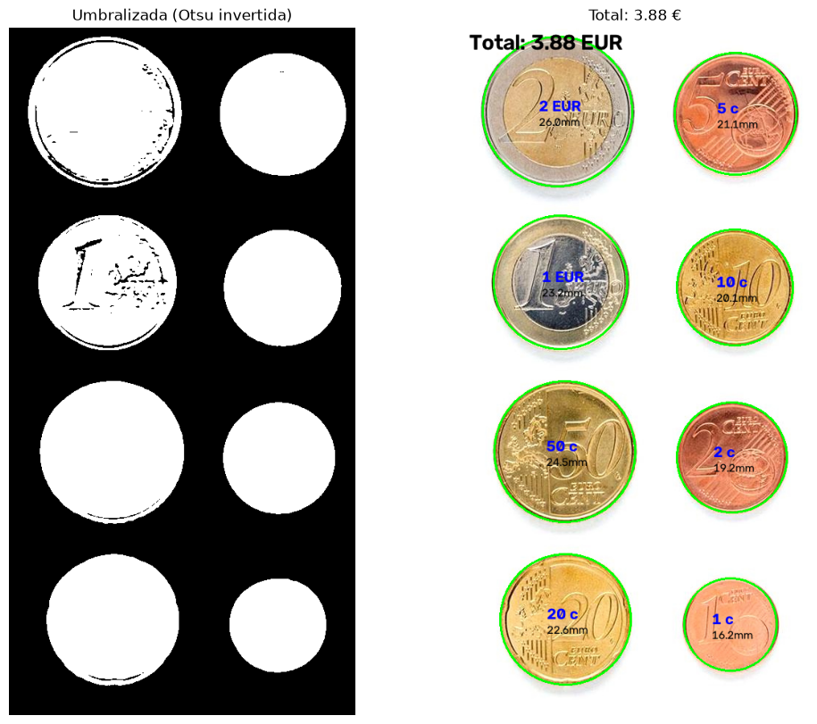
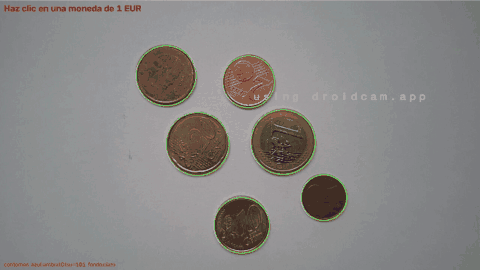
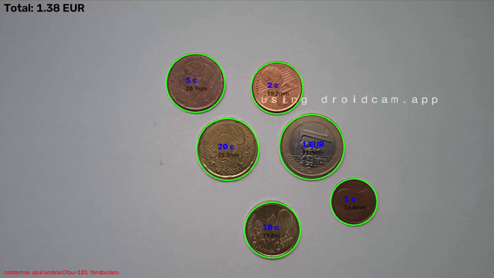
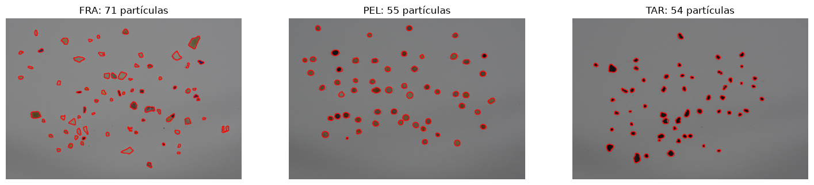
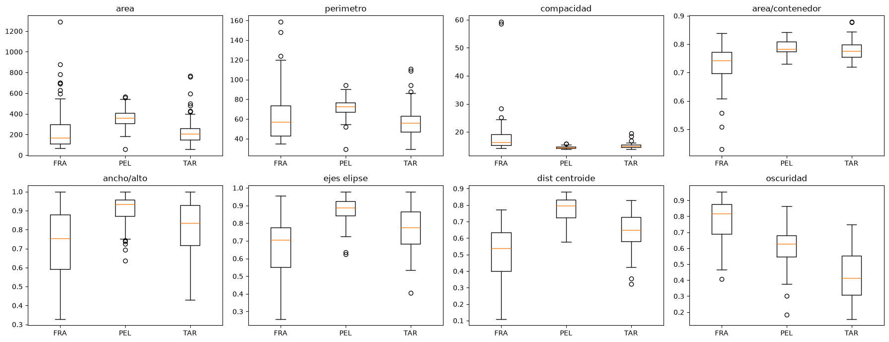
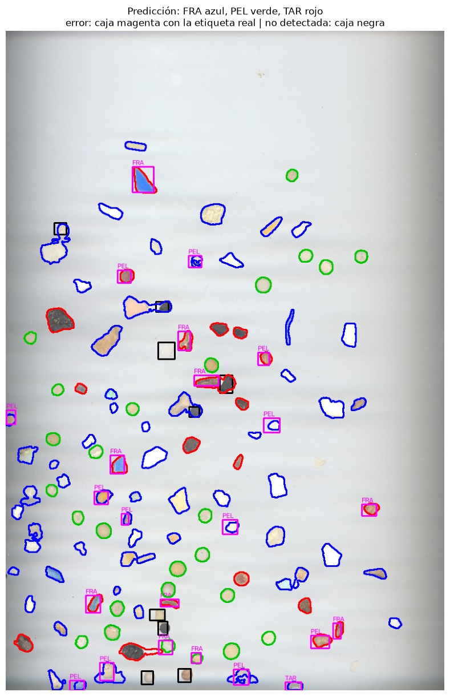
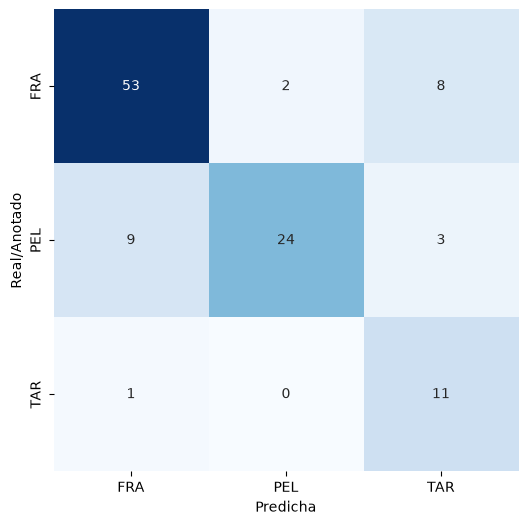

# Práctica 3. Detección y reconocimiento de formas

Visión por Computador — Curso 2026/27

Esta práctica tiene dos tareas, resueltas en el cuaderno [VC_P3.ipynb](VC_P3.ipynb) **sin modelos de aprendizaje profundo**, solo con OpenCV, NumPy y scikit-learn (este último únicamente para las métricas):

1. **Contar dinero**: calcular el dinero que hay en una imagen de monedas y en vídeo en vivo desde la cámara.
2. **Clasificar microplásticos**: segmentar las partículas de una imagen y clasificarlas en fragmentos (FRA), *pellets* (PEL) y alquitrán (TAR).

### Contenidos

- [Requisitos y ejecución](#requisitos-y-ejecución)
- [Tarea 1: Contar dinero](#tarea-1-contar-dinero)
- [Tarea 2: Clasificación de microplásticos](#tarea-2-clasificación-de-microplásticos)
- [Uso de herramientas de IA](#uso-de-herramientas-de-ia)
- [Ficheros del repositorio](#ficheros-del-repositorio)

---

## Requisitos y ejecución

```
pip install opencv-python numpy matplotlib scikit-learn seaborn
```

Se abre `VC_P3.ipynb` y se ejecutan las celdas en orden. Notas:

- **Calibración de la imagen ideal (1.2)**: se abre una ventana de OpenCV y hay que hacer clic sobre la moneda de 1 €. Para ejecutarla sin interacción, basta con poner `PUNTO_REF = (134, 347)`.
- **Demostrador en vivo (1.3)**: se lee la cámara del móvil directamente de la app DroidCam, que debe estar abierta, con el cliente DroidCam del PC **cerrado** (si no, la app responde «DroidCam is Busy»). Si el móvil está conectado por cable con la depuración USB activada, la celda ejecuta `adb forward tcp:4747 tcp:4747` y lee `http://127.0.0.1:4747/video`; si no, usa la WiFi con la IP de `IP_WIFI`, que es la que muestra la app. Para la webcam del portátil, `FUENTE = 0`.

---

## Tarea 1: Contar dinero

### Procedimiento

1. **Segmentación**: suavizado Gaussiano y umbralizado binario invertido con Otsu (también admite un umbral fijo). En lugar del gris se umbraliza el **canal azul**: las monedas doradas y de cobre tienen muy poco azul, así que destacan sobre el folio blanco incluso con poca luz.
2. **Contornos externos** (`findContours` con `RETR_EXTERNAL`). Para cada uno se calculan:
   - el **área**, para descartar el ruido;
   - la **compacidad** P²/A (un círculo da 4π ≈ 12.6);
   - la **relación entre ejes** de la elipse ajustada con `fitEllipse` (un círculo da 1).

   Si ambas son próximas a las de un círculo, el contorno se considera una moneda. Si no, se marca como *otro objeto* o monedas solapadas. Los contornos que tocan el borde de la imagen se descartan porque la moneda está cortada.
3. **Radio = semieje menor de la elipse**. La sombra alarga la moneda solo en la dirección de la luz, y el eje perpendicular sigue midiendo el diámetro real. Daba mejores resultados que `minEnclosingCircle` y que `HoughCircles`.
4. **Calibración**: el usuario hace clic en la moneda de 1 € y se obtiene `px_por_mm = 2·r / 23.25`.
5. **Clasificación por tamaño y color**: cada diámetro se pasa a mm y se le asigna la moneda con el diámetro oficial más cercano, o ninguna si la diferencia supera `TOL_MM = 0.7 mm`. Antes se separan las monedas por **color** con la relación verde/rojo dentro de la moneda: las de cobre (1c, 2c, 5c) tienen G/R ≈ 0.60–0.70 y las doradas y bimetálicas, G/R ≥ 0.75. Cada moneda solo se compara con las de su grupo, y así no se confunden monedas de tamaño parecido y distinto material, como el 5c (21.25 mm) y el 20c (22.25 mm).
6. Para monedas solapadas, también se puede detectar con la **Transformada de Hough** (`HoughCircles` tras `medianBlur`), activándola con la tecla `h`.

### Resultado con la imagen ideal

Con Otsu se detectan los 8 contornos (compacidad ≈ 14 y relación de ejes ≈ 1). Tras calibrar con el 1 €, las ocho monedas se clasifican bien: **total 3.88 €** (2 € + 1 € + 50c + 20c + 10c + 5c + 2c + 1c).



### Demostrador en vivo

Controles: **clic** en el 1 € para calibrar · `r` borra la calibración · `h` cambia entre contornos y Hough · `o` cambia entre Otsu y umbral fijo (`+`/`-` lo ajustan) · `a` cambia entre canal azul y gris · `f` cambia entre fondo claro y oscuro · `ESC` sale.

Montaje: monedas sobre un folio blanco y la cámara del móvil (DroidCam) cenital y fija.



*Vídeo completo: [2026-10-19 17-22-09.mkv](2026-10-19%2017-22-09.mkv)*

En el vídeo:

- Antes de calibrar, las monedas detectadas se marcan en amarillo.
- Tras hacer clic en el 1 €, se reconocen las seis monedas (1 € + 20c + 10c + 5c + 2c + 1c) y el total es **1.38 €**, el correcto.
- En muchos fotogramas el 1 € aparece en rojo («?») y el total baja a **0.38 €**. Su diámetro medido varía de un fotograma a otro y a veces se sale de la tolerancia de 0.7 mm. Hay monedas que solo se diferencian en 1 mm (1 € 23.25 / 50c 24.25 / 20c 22.25), y con esta escala 1 px ≈ 0.15 mm, así que pocos píxeles de error bastan.
- Al final del vídeo, al moverse la escena y volver a calibrar, la escala cambia: el 1 € pasa a clasificarse como 20c, otras monedas quedan sin reconocer y el total baja a 0.31 €.


*Fotograma con las seis monedas reconocidas (1.38 €)*

### Problemas observados y limitaciones

- **Iluminación**: en una primera prueba con poca luz, el umbral sobre el gris (Otsu = 54) no separaba las monedas claras del fondo y solo segmentaba su sombra. Se corrigió umbralizando el canal azul. Los reflejos rompen el contorno y las sombras pegadas aumentan el diámetro.
- **Escala y perspectiva**: la relación px/mm solo vale a la distancia a la que se calibró. Con la cámara algo inclinada, la escala variaba de 6.46 a 6.85 px/mm de una esquina a otra (un 6 %, unos 1.3 mm en una moneda de 22 mm), y un 20c cercano a la cámara se clasificaba como 1 €. Con la cámara paralela a la mesa el problema desaparece.
- **Estabilidad entre fotogramas**: como muestra el vídeo, el ruido de la cámara hace que el diámetro de una moneda oscile cerca del límite de la tolerancia. Promediar varios fotogramas lo atenuaría.
- **Otros objetos**: los no circulares se rechazan por compacidad y relación de ejes, y los circulares de otro tamaño por la tolerancia, pero un objeto redondo del tamaño de una moneda se contaría.
- **Solape**: dos monedas que se tocan forman un solo contorno no circular y se descartan. Con Hough se pueden separar, aunque es más sensible a los parámetros.

---

## Tarea 2: Clasificación de microplásticos

Las imágenes de **entrenamiento** son las tres fotos completas (`fragment-03`, `pellet-03` y `tar-03`, de 4608×3456 y con una sola clase cada una), reducidas a ¼. `MPs_test.jpg` **solo se usa para evaluar**.

### Segmentación

Un umbral global falla aquí: el fondo no es uniforme (viñeteado en las fotos, bandas en el escáner del test) y hay partículas más claras que el fondo (fragmentos blancos) y otras más oscuras (alquitrán). Se aplica la idea del umbralizado adaptativo, comparando cada píxel con su entorno:

1. Se estima el **fondo** con `medianBlur` 51×51, una ventana mucho mayor que las partículas, que las borra.
2. Se calcula la **diferencia absoluta** con el fondo, tomando el canal en el que es mayor. Así se detectan las partículas claras, las oscuras y las de color.
3. `GaussianBlur` y **umbral fijo de 12**, elegido con las imágenes de entrenamiento para que salga el número de partículas indicado (≈80 FRA, ≈55 PEL, ≈54 TAR). Otsu daba un umbral demasiado alto y se perdían los fragmentos blancos.
4. Contornos externos y filtro por área mínima (30 px).

Partículas obtenidas: **71 FRA, 55 PEL y 54 TAR**.



### Características

Las de SMACC más una de apariencia:

| Característica | FRA | PEL | TAR |
|---|---|---|---|
| Compacidad P²/A | 16.36 ± 7.43 | 14.39 ± 0.44 | 14.91 ± 0.98 |
| Área / área del contenedor (`minAreaRect`) | 0.74 ± 0.07 | 0.78 ± 0.02 | 0.78 ± 0.03 |
| Ancho / alto del contenedor | 0.75 ± 0.18 | 0.93 ± 0.08 | 0.83 ± 0.13 |
| Ejes de la elipse (menor / mayor) | 0.71 ± 0.16 | 0.89 ± 0.07 | 0.78 ± 0.12 |
| Distancia mín. / máx. del centroide al contorno | 0.54 ± 0.15 | 0.80 ± 0.07 | 0.65 ± 0.11 |
| **Oscuridad relativa** (mediana del gris de la partícula / mediana del fondo) | 0.82 ± 0.13 | 0.63 ± 0.12 | 0.41 ± 0.15 |

*(mediana ± desviación típica en el entrenamiento)*

El área y el perímetro se calculan pero **no se usan para clasificar**, porque la escala del test es distinta.



### Clasificador

- **Alquitrán**: es negro y se separa por **oscuridad relativa**. El umbral no puede fijarse con el entrenamiento, porque la cámara y el escáner tienen curvas de tono muy distintas (el alquitrán da un gris de 16 sobre un fondo de 122 en las fotos, y de 90 sobre 220 en el escáner). Por eso el umbral se calcula **en cada imagen con Otsu** sobre la oscuridad de sus partículas, sin usar las anotaciones (0.604 en el entrenamiento y 0.804 en el test).
- **Pellets frente a fragmentos**: pueden ser de cualquier color, así que se separan **solo por la forma** (compacidad, ejes de la elipse y distancias al centroide) con un clasificador de **media más cercana**, normalizando cada característica por su desviación típica.

Sobre las 180 partículas de entrenamiento la accuracy es **0.778**.

### Evaluación sobre `MPs_test.jpg`

Cada anotación del CSV se empareja con la partícula detectada de mayor **IoU** entre cajas. Si el IoU es menor de 0.3, la anotación se considera **no detectada** y se informa aparte.

- Partículas detectadas: 113
- Anotaciones evaluadas: **111 de 120** (9 no detectadas: 4 TAR, 3 FRA, 2 PEL)


*Contorno con el color de la predicción (FRA azul, PEL verde, TAR rojo). Errores: caja magenta con la etiqueta real. No detectadas: caja negra.*

### Métricas

| Métrica (ponderada) | Valor |
|---|---|
| Accuracy | **0.793** |
| Precision | **0.831** |
| Recall | **0.793** |
| F1 Score | **0.799** |

| Clase | Precision | Recall | F1 |
|---|---|---|---|
| FRA | 0.84 | 0.84 | 0.84 |
| PEL | 0.92 | 0.67 | 0.77 |
| TAR | 0.50 | 0.92 | 0.65 |

### Matriz de confusión

| Real \ Predicha | FRA | PEL | TAR |
|---|---|---|---|
| **FRA** | 53 | 2 | 8 |
| **PEL** | 9 | 24 | 3 |
| **TAR** | 1 | 0 | 11 |



### Conclusiones

- **Confusiones principales**:
  - **PEL → FRA** (9): pellets irregulares, aplastados o pegados a otra partícula.
  - **FRA → TAR** (8): fragmentos marrones o grises oscuros que quedan por debajo del umbral de oscuridad.
  - El alquitrán se reconoce casi siempre (11 de 12 detectados), pero con precisión baja por esos fragmentos oscuros.
- **Características más útiles**: la oscuridad relativa para el alquitrán y, para pellets y fragmentos, la relación de distancias al centroide (0.80 frente a 0.54), los ejes de la elipse (0.89 frente a 0.71) y la compacidad. El área, el perímetro y el color absoluto no sirven cuando las imágenes tienen escalas y sensores distintos.
- **Segmentación**: con un umbral global se perdían casi todos los fragmentos blancos y transparentes. Con `adaptiveThreshold` quedaban 36 partículas del test sin detectar, y restando el fondo estimado con la mediana, solo 9. Las partículas que se tocan forman un solo contorno, y la sombra del borde inferior del escáner se une a algunas.
- **Cambio de dominio**: es la principal dificultad. El entrenamiento son fotos y el test, un escaneo. Un umbral de oscuridad fijo sacado del entrenamiento no reconocía casi ningún alquitrán del test. Calcularlo en cada imagen con Otsu lo resuelve sin usar las anotaciones.

---

## Uso de herramientas de IA

- Durante el desarrollo de la práctica se usó **Claude Code (Anthropic)** con agentes de código como asistente de programación.
- Este README se redactó con ayuda de **Claude Code (Anthropic)** a partir del cuaderno, sus resultados y el vídeo de la demostración. El GIF y las figuras de la carpeta `imagenes/` se extrajeron automáticamente del vídeo y de las salidas del cuaderno.

---

## Ficheros del repositorio

| Fichero | Descripción |
|---|---|
| `VC_P3.ipynb` | Cuaderno con la resolución de las dos tareas |
| `VC_P3_original.ipynb` | Cuaderno original proporcionado |
| `2026-10-19 17-22-09.mkv` | Vídeo del demostrador en vivo de la Tarea 1 |
| `imagenes/` | Figuras y GIF usados en este README |
| `Monedas.jpg`, `ScreenshotMonedas.png` | Imagen ideal de monedas y captura de la webcam |
| `fragment-03…`, `pellet-03…`, `tar-03…` | Imágenes de entrenamiento de la Tarea 2 |
| `FRA.png`, `PEL.png`, `TAR.png` | Subimágenes de cada clase (no usadas para entrenar) |
| `MPs_test.jpg`, `MPs_test_bbs.csv` | Imagen de test y sus anotaciones |
| `MatrizConfu.png` | Ejemplo de matriz de confusión del enunciado |

***
Bajo licencia de Creative Commons Reconocimiento - No Comercial 4.0 Internacional
